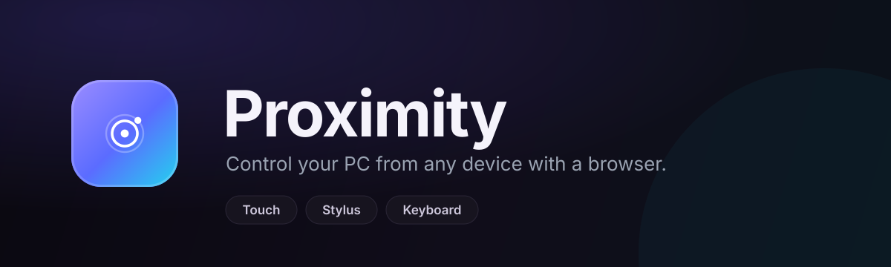

# Proximity

<p align="center">
  
</p>

Control your PC from any device with a web browser — touch, stylus, mouse and a
**working on-screen keyboard** on your phone.

Proximity is an AGPL-3.0 fork of
[Weylus](https://github.com/H-M-H/Weylus) by H-M-H with additional features.

## What was added compared to upstream Weylus

- New `TextEvent` protocol message (browser -> server over websocket).
- **Redesigned desktop GUI** following the AniShell launcher design system:
  a floating island sidebar (224px rail, 44px rows, accent icon on the
  selected entry), matte graphite surfaces with hairlines, Segoe UI +
  Consolas typography, tracked uppercase eyebrows, compact spring toggles,
  hover fades, a pulsing live-status dot with a bounce/ripple on server state
  changes, and 23 color palettes (including the launcher's exact dark/light
  pair) with a live theme picker.
- **"Toggle Keyboard"** button in the web UI: opens a small text funnel on the
  device page. Whatever you type on your phone's *soft* keyboard (including
  Unicode/Cyrillic) is injected into the host:
  - Windows: `SendInput` with `KEYEVENTF_UNICODE`, so any character works
    without a physical layout mapping (batched down/up, surrogate pairs safe).
  - macOS/X11: characters are synthesized through `autopilot`.
  - Linux: uinput CTRL+SHIFT+U unicode insertion.
- Enter/Backspace from the soft keyboard are translated to proper key events.
- Upstream Weylus explicitly does *not* support on-screen keyboards; this fork
  exists to fill exactly that gap.

## Usage

1. Start Proximity on the PC and press **Start** (web port 1701, websocket
   port 9001 by default, bind address `0.0.0.0`).
2. On your phone/tablet open `http://<PC-IP>:1701` in the browser (same local
   network). A QR code is shown in the GUI for convenience.
3. Optionally set an **Access code** in the GUI.
4. For typing tap **Toggle Keyboard** in the settings panel and tap the text
   field — your device's keyboard opens and keystrokes land on the PC.

Graceful use tips: NVENC (NVIDIA) or Media-Foundation hardware encoding can be
enabled in the GUI before starting the server. Both TCP ports 1701/9001 must be
open in the host firewall.

## Building

Requirements (same as upstream): Rust, TypeScript, bash, make, a C compiler and
nasm; ffmpeg/x264 are built from source automatically. Alternatively configure
with the `ffmpeg-system` feature.

Easiest is the bundled GitHub Actions workflow (manual `workflow_dispatch`):
it builds the Windows binary (mingw cross-compile), the Linux binary and a deb
inside the official `hhmhh/weylus_build:latest` container and uploads artifacts.

### Windows / MSVC (local)

A native MSVC build works too; it needs an FFmpeg distribution with headers,
import libraries and DLLs. The `ffmpeg-system` feature links against
`deps/dist_windows`, so put the FFmpeg `include/`, `lib/` and `bin/` trees
there (a BtbN or gyan.dev Windows build works) and run:

```powershell
$env:RUSTFLAGS = "-L deps\dist_windows\lib"
cargo build --features ffmpeg-system,fltk/fltk-bundled
```

`fltk/fltk-bundled` compiles FLTK from source, so no system FLTK is needed.
Copy the FFmpeg DLLs next to the resulting `proximity.exe`. When iterating on
UI code, `PROXIMITY_SKIP_FFMPEG_CC=1` lets `cargo check` skip the C helpers
and the vendored FFmpeg build, but a full `cargo build` needs them.

Log level can be tuned with the `PROXIMITY_LOG_LEVEL` and `PROXIMITY_LOG_JSON`
environment variables.

## Brand

The app mark is [`assets/logo.svg`](assets/logo.svg); the desktop window uses
the same artwork and the transparent [`assets/logo-glyph.svg`](assets/logo-glyph.svg)
is tinted with the active palette in the sidebar. The README banner lives in
[`assets/banner.svg`](assets/banner.svg); [`assets/social-preview.svg`](assets/social-preview.svg)
is the matching 1280x640 card for GitHub's social preview.
[`assets/logo.png`](assets/logo.png) and
[`assets/social-preview.png`](assets/social-preview.png) are ready-to-upload
PNG exports, and [`assets/proximity.ico`](assets/proximity.ico) is the Windows
shortcut icon.

GitHub does not take a repository icon from the source tree — the closest
repository-level image is the social preview under **Settings → General**.
Upload `assets/social-preview.png` there. On Linux the icon is installed to
the hicolor theme by the `.deb` packaging.

## License

AGPL-3.0-or-later, unchanged from upstream — see [LICENSE](LICENSE).
All credit for the original Weylus goes to H-M-H and contributors.
